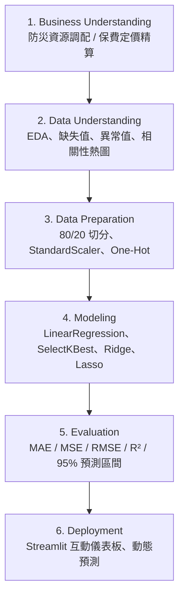

# AIoT HW2: 多元線性回歸與 CRISP-DM 實踐 (Multiple Linear Regression)

> **課程名稱**：物聯網數據分析與應用 (AIoT Data Analysis and Applications)  
> **作業項目**：HW2 — Kaggle Dataset × Multiple Linear Regression × CRISP-DM  
> **主要成果**：GitHub 儲存庫 + Streamlit Web 互動應用系統

---

## 📌 專案摘要 (Executive Summary)

本專案依據 **CRISP-DM (Cross-Industry Standard Process for Data Mining)** 六大標準階段，建構嚴謹的多元線性回歸 (Multiple Linear Regression) 預測系統與資料科學工作流。
針對 Kaggle 真實競賽公開資料集，全面落實：
1. **嚴防資料洩漏 (No Data Leakage)**：嚴格分離訓練集與測試集 (80/20 Hold-out)，所有補值、編碼、標準化與特徵選擇均僅在訓練集擬合。
2. **多階段特徵選擇 (Feature Selection)**：實作 Filter 方法（`SelectKBest` with F-regression）與正規化方法（Ridge / Lasso）進行特徵篩選與比較。
3. **95% 預測區間量化 (Uncertainty Quantification)**：清楚區隔「平均值信賴區間 (Confidence Interval)」與「個別觀測值預測區間 (Prediction Interval)」，並視覺化呈現。
4. **雙主題下拉選單 (+1 分加分項)**：支援切換「洪水機率預測 (Flood Prediction, 20 特徵)」與「保費金額預測 (Insurance Premium, 19 特徵)」。
5. **任意外部 CSV 預測支援 (+2 分加分項)**：支援使用者自訂遠端 CSV URL 或本機上傳，動態指定連續 Target 進行回歸分析與安全檢驗。

---

## 🏆 Kaggle 問題與資料規格

| 項目 | 主題 A (主要必做) | 主題 B (加分切換) | 加分示範資料 (URL/Upload) |
|---|---|---|---|
| **問題名稱** | **Predict the Flood** | **Insurance Premium Prediction** | **50 Startups** |
| **Kaggle 競賽** | [Playground Series s4e5](https://www.kaggle.com/competitions/playground-series-s4e5) | [Playground Series s4e12](https://www.kaggle.com/competitions/playground-series-s4e12) | [GitHub 外部 CSV](https://raw.githubusercontent.com/Avik-Jain/100-Days-Of-ML-Code/master/datasets/50_Startups.csv) |
| **目標變數 (Target)** | `FloodProbability` (連續數值 `0.285` ~ `0.725`) | `Premium Amount` (連續數值，保險金額) | `Profit` (連續數值) |
| **原始輸入特徵數** | **20 個** (符合 14–39 規格，純數值指標) | **19 個** (符合 14–39 規格，8 數值 + 11 類別) | 4 個 (僅供動態上傳測試) |
| **資料筆數** | 1,117,957 筆 | 1,200,000 筆 | 50 筆 |
| **隨機種子** | `random_state = 42` | `random_state = 42` | `random_state = 42` |

---

## 🔬 CRISP-DM 六大階段架構



### 1. 商業理解 (Business Understanding)
- 透過氣候、基建與治理指標預估洪水風險，協助主管機關在強降雨來臨前精確調度抽水機與防汛沙包。
- 建立透明、可解釋的多元線性回歸模型，明確各特徵權重係數。

### 2. 資料理解 (Data Understanding)
- 檢驗 20 個特徵之統計分布、偏態、峰度、缺失率與重複列。
- 繪製目標變數直方圖、特徵相關係數熱圖 (Heatmap)。

### 3. 資料準備 (Data Preparation)
- 建立 `Pipeline` 與 `ColumnTransformer`。
- 數值欄位以 `StandardScaler` 標準化；類別欄位以 `OneHotEncoder(handle_unknown='ignore')` 編碼。
- 嚴格鎖定於訓練集內擬合 (`fit`)，杜絕測試資料外洩。

### 4. 建模與特徵選擇 (Modeling & Feature Selection)
- **基準模型 (Baseline)**：DummyRegressor (均值常數預測) 與全特徵 LinearRegression。
- **特徵選擇**：使用 `SelectKBest(score_func=f_regression)` 評估特徵重要性，篩選核心特徵子集。
- **正則化對照**：導入 Ridge 與 Lasso 交叉驗證，檢視共線性抑制效果與特徵稀疏性。

### 5. 模型評估 (Evaluation)
- 指標比較：MAE、MSE、RMSE、R² 及 Adjusted R²。
- 殘差診斷：Residual vs. Fitted 圖、Normal Q-Q Plot、方差齊性與多重共線性 (VIF) 檢驗。
- **95% 預測區間 (Prediction Interval)**：透過殘差分位數與 OLS 估計個體預測不確定性。

### 6. 部署 (Deployment)
- 採用 Streamlit 打造 Web UI，提供單筆參數即時推論與動態區間視覺化。

---

## 💻 專案目錄結構

```text
AIoT_HW2/
├── README.md                      # 專案總覽與執行指南
├── HW2_EXECUTION_PLAN.md          # 驗收標準與 Gate 執行計畫
├── requirements.txt               # Python 依賴清單
├── app.py                         # Streamlit Web 主應用
├── src/                           # 核心管線模組
│   ├── __init__.py
│   ├── data_loader.py             # 資料載入與快取
│   ├── preprocessing.py          # 前處理管線 (Pipeline)
│   ├── feature_selection.py      # SelectKBest / Lasso
│   ├── modeling.py               # 線性回歸與對照模型
│   ├── evaluation.py             # 評估指標與殘差分析
│   └── intervals.py              # 95% 信賴/預測區間演算法
├── notebooks/                     # 分析與實驗 Notebooks
│   └── hw2_crisp_dm.ipynb
├── data/                          # 資料集目錄 (依 GitIgnore 排除原始大檔)
│   ├── README.md                  # 資料來源與下載手冊
│   ├── flood/                     # 主題 A 資料 (train.csv)
│   └── insurance/                 # 主題 B 資料 (train.csv)
├── reports/                       # 分析報告與研究紀錄
│   ├── HW2_REPORT.md              # 完整書面成果
│   ├── notebooklm_summary.md      # NotebookLM 文獻摘要 (>=100字)
│   └── gpt_assistance.md          # AI/GPT 輔助說明
├── figures/                       # 自動產出之高解析度圖表
└── tests/                         # 單元與整合測試
    ├── __init__.py
    └── test_pipeline.py
```

---

## 🚀 快速開始 (Quick Start)

### 1. 建立並啟用虛擬環境
```bash
# Windows PowerShell
python -m venv .venv
.\.venv\Scripts\Activate.ps1
```

### 2. 安裝依賴套件
```bash
pip install --upgrade pip
pip install -r requirements.txt
```

### 3. 執行單元測試
```bash
pytest tests
```

### 4. 啟動 Streamlit 互動式 Web 系統
```bash
streamlit run app.py
```
啟動後於瀏覽器開啟 `http://localhost:8501` 即可操作。

---

## 🤖 AI 與文獻研究揭露 (Disclosures)

- **NotebookLM 深度摘要**：詳見 [reports/notebooklm_summary.md](file:///c:/Users/User/Desktop/博士班上課/物聯網數據分析與應用/AIoT_HW2/reports/notebooklm_summary.md)。
- **GPT 協同開發紀錄**：詳見 [reports/gpt_assistance.md](file:///c:/Users/User/Desktop/博士班上課/物聯網數據分析與應用/AIoT_HW2/reports/gpt_assistance.md)。
