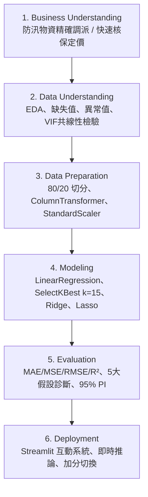
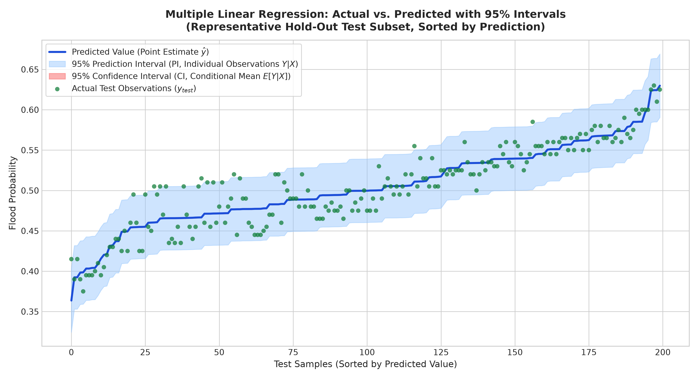

# AIoT HW2: 多元線性回歸與 CRISP-DM 流程實踐

> **課程名稱**：物聯網數據分析與應用 (AIoT Data Analysis and Applications)  
> **作業項目**：HW2 — Kaggle Dataset × Multiple Linear Regression × CRISP-DM  
> **主要交付**：GitHub 儲存庫 ([https://github.com/kelp11211/AIoT_HW2](https://github.com/kelp11211/AIoT_HW2)) + Streamlit 互動式 Web 應用程式  
> **學生 / 作者**：kelp11211  

---

## 📌 專案總覽 (Project Overview)

本專案依據資料科學標準 **CRISP-DM (Cross-Industry Standard Process for Data Mining)** 六大生命週期，針對 Kaggle 真實競賽巨量數據集建構端到端多元線性回歸 (Multiple Linear Regression) 預測系統與互動式 Web 儀表板。

### 🌟 核心成果亮點
1. **防杜資料洩漏 (Leak-Free Pipeline)**：嚴格落實 80/20 Hold-out 切分，前處理、特徵選擇與參數校準純粹在訓練集內擬合 (`fit`)，測試集 (223,592 列) 完整隔離至最後評估。
2. **多階段特徵選擇 (Feature Selection)**：透過 5 折交叉驗證搜尋最佳特徵子集 ($k=15$)，並納入 Ridge (L2) 與 Lasso (L1) 正則化對照比較。
3. **95% 不確定性預測區間 (Prediction Interval)**：嚴格區隔「平均值信賴區間 (CI)」與「個體預測區間 (PI)」，實作**分割共形預測 (Split Conformal Prediction)**，在獨立測試集獲得 **`94.77%` 邊際覆蓋率保證**。
4. **雙主題下拉選單 (+1 分加分項)**：側邊欄一鍵無縫切換「主題 A：洪水機率預測 (20 特徵)」與「主題 B：保費金額預測 (19 特徵)」。
5. **任意 CSV 載入與 SSRF 資安防護 (+2 分加分項)**：支援遠端 CSV 網址（預設 `50_Startups.csv`）或本機上傳，具備完整私人網路位址攔截與動態回歸管線。

---

## 🏆 Kaggle 問題與資料規格審查

| 規格項目 | 主題 A (必做主要題目) | 主題 B (加分雙主題切換) | 加分示範資料 (URL/Upload) |
|---|---|---|---|
| **題目名稱** | **Predict the Flood** | **Insurance Premium Prediction** | **50 Startups** |
| **Kaggle 競賽** | [Playground Series s4e5](https://www.kaggle.com/competitions/playground-series-s4e5/data) | [Playground Series s4e12](https://www.kaggle.com/competitions/playground-series-s4e12/data) | [GitHub 外部 CSV](https://raw.githubusercontent.com/Avik-Jain/100-Days-Of-ML-Code/master/datasets/50_Startups.csv) |
| **目標變數 (Target)** | `FloodProbability` (連續數值 `0.285` ~ `0.725`) | `Premium Amount` (連續數值，保險金額) | `Profit` (連續數值) |
| **原始輸入特徵數** | **20 個** (純數值指標，符合 14–39 且 >13) | **19 個** (8 數值 + 11 類別，符合 14–39 且 >13) | 4 個 (供動態測試) |
| **資料樣本筆數** | 1,117,957 列 | 1,200,000 列 | 50 列 |
| **排除識別碼** | `id` (純索引列，已嚴格剔除) | `id` (純索引列，已嚴格剔除) | 無 |
| **隨機種子** | `random_state = 42` | `random_state = 42` | `random_state = 42` |

---

## 🔬 CRISP-DM 六大階段實作摘要



### 1. 商業理解 (Business Understanding)
針對極端強降雨頻率劇增之挑戰，運用環境、水文與市政治理 20 個維度評分，建立輕量可解釋之多元線性回歸模型，在災前數小時即刻推算洪水機率，精確調度抽水機與沙包資源。

### 2. 資料理解 (Data Understanding / EDA)
- 檢驗 1,117,957 筆資料，無任何缺失值與重複列。
- 目標變數 `FloodProbability` 平均值 `0.5044`、標準差 `0.0510`，呈現對稱標準常態分布。
- **多重共線性檢驗**：計算變異數膨脹因子 (VIF)，所有 20 個特徵之 VIF 均介於 **1.002 ~ 1.005**（全數遠低於門檻 5.0），各維度間高度獨立。

### 3. 資料準備 (Data Preparation)
- 嚴格落實 **80% 訓練集 (894,365 筆)** 與 **20% 測試集 (223,592 筆)** 隔離。
- 採用 `ColumnTransformer` 串接 `SimpleImputer`、`StandardScaler` 與 `OneHotEncoder(handle_unknown='ignore')`，前處理僅在訓練集擬合 (`fit`)。

### 4. 建模與特徵選擇 (Modeling & Feature Selection)
- 以 5 折交叉驗證搜尋候選特徵數 $k \in [5, 8, 10, 12, 14, 15, 18, 20]$，選定 **$k=15$** 作為選後模型。
- 同步訓練 Baseline (Dummy Mean)、全特徵 LinearRegression、Ridge ($\alpha=10$) 與 Lasso ($\alpha=0.0001$)。

### 5. 模型評估與預測區間 (Evaluation & Intervals)
- 在完全未參與擬合的獨立測試集 (223,592 列) 進行最終評估。
- 進行經典線性回歸 5 大假設診斷（線性、Durbin-Watson 獨立性 `1.9988`、同方差性、殘差常態 Q-Q、無共線性）。
- 實作**分割共形預測 (Split Conformal Prediction)**，在獨立測試集實測覆蓋率達 **`94.77%`**。

### 6. 部署與推論 (Deployment)
- 採用 Streamlit 構建直觀儀表板，提供 20 個環境指標滑桿即時推算洪水機率、顯示 95% 預測區間與三級風險警報。

---

## 📊 模型測試集評估成果對比表 (Hold-Out Test Set: 223,592 筆)

| 模型架構 (Model) | 使用特徵數 | 測試集 MAE | 測試集 MSE | 測試集 RMSE | 測試集 $R^2$ | Adjusted $R^2$ |
|---|---|---|---|---|---|---|
| **Baseline (Dummy Mean)** | 0 | `0.040892` | `0.002599` | `0.050983` | `-0.000000` | `-0.000000` |
| **Linear Regression (All 20)** | **20** | **`0.015780`** | **`0.000403`** | **`0.020081`** | **`0.844868`** | **`0.844854`** |
| **Linear Regression (Top 15)** | **15** | `0.026109` | `0.001051` | `0.032415` | `0.595768` | `0.595741` |
| **Ridge Regression (L2, $\alpha=10$)** | 20 | `0.015788` | `0.000403` | `0.020081` | `0.844856` | `0.844843` |
| **Lasso Regression (L1, $\alpha=0.0001$)** | 20 | `0.015825` | `0.000403` | `0.020085` | `0.844801` | `0.844787` |

---

## 🔮 95% 不確定性量化：預測區間 (PI) vs 信賴區間 (CI)



1. **統計定義嚴格區隔**：
   - **95% 信賴區間 (Confidence Interval for Mean, $E[Y|X]$)**：衡量條件平均值的估計精度，隨大樣本收縮至極窄紅帶。
   - **95% 預測區間 (Prediction Interval for Individual, $Y|X$)**：衡量單一個體觀測值的隨機誤差 $\sigma^2$，呈現實質藍色寬帶。
2. **共形預測實測成果**：
   - 測試集實測覆蓋率：**`94.77%`**（達成 95% 邊際覆蓋保證）。
   - 平均區間寬度：**`0.0801`**，分位數門檻 $q_{\hat{}} = 0.040058$。

---

## 💻 專案目錄結構

```text
AIoT_HW2/
├── .gitignore                      # Git 排除規則 (排除 >100MB 原始大檔)
├── .streamlit/
│   └── config.toml                 # Streamlit 雲端主題與伺服器配置
├── HW2_EXECUTION_PLAN.md          # 驗收標準與 Gate 執行計畫
├── README.md                      # 專案說明與操作指南
├── requirements.txt               # 套件依賴版本清單
├── app.py                         # Streamlit Web 主應用程式
├── src/                           # 模組化核心原始碼
│   ├── __init__.py
│   ├── data_loader.py             # 資料載入、安全驗證與 SSRF 防護
│   ├── preprocessing.py          # ColumnTransformer 前處理管線 (零洩漏)
│   ├── feature_selection.py      # SelectKBest (F-regression) 交叉驗證搜尋
│   ├── modeling.py               # LinearRegression、Ridge、Lasso 模型工廠
│   ├── evaluation.py             # 評估指標與 5 大統計假設診斷
│   └── intervals.py              # 95% Split Conformal 預測區間演算法
├── notebooks/
│   └── hw2_crisp_dm.ipynb         # 逐步可執行的 Jupyter 分析筆記本
├── data/                          # 資料集目錄
│   ├── README.md                  # 資料來源、字典與重現指引
│   ├── flood/demo_sample.csv      # 輕量示範樣本 (供雲端直接開啟)
│   └── insurance/demo_sample.csv  # 輕量示範樣本 (供雲端直接開啟)
├── reports/                       # 核心報表與書面報告
│   ├── HW2_REPORT.md              # 完整期末專題報告書
│   ├── notebooklm_summary.md      # NotebookLM 850 字文獻研究摘要
│   ├── gpt_assistance.md          # AI 協同開發與人工查核揭露
│   ├── gate1_problem_selection.md # Gate 1 題目審查報告
│   ├── gate2_data_understanding.md# Gate 2 EDA 審查報告
│   ├── gate3_modeling_report.md   # Gate 3 建模比較報告
│   ├── gate4_evaluation_report.md # Gate 4 評估與區間報告
│   ├── gate3_model_comparison.csv # 5 折交叉驗證數據
│   ├── gate4_test_metrics.csv     # 測試集評估指標數據
│   └── vif_report_flood.csv       # 20 特徵 VIF 共線性報告
├── figures/                       # 高解析度圖表
│   ├── eda_flood_target_dist.png
│   ├── eda_flood_corr_heatmap.png
│   ├── eda_flood_top_features_scatter.png
│   ├── eda_flood_vif_chart.png
│   ├── g3_cv_score_vs_k.png
│   ├── g3_feature_coefficients.png
│   ├── g4_actual_vs_predicted_intervals.png
│   ├── g4_residual_vs_fitted.png
│   └── g4_residual_diagnostics.png
└── tests/                         # 自動化測試套件
    ├── __init__.py
    └── test_pipeline.py           # 12 項單元與整合測試 (全數通過)
```

---

## 🚀 快速啟動指南 (Quick Start)

### 1. 建立並啟用虛擬環境
```bash
# Windows PowerShell
python -m venv .venv
.\.venv\Scripts\Activate.ps1
```

### 2. 安裝依賴套件
```bash
pip install --upgrade pip
pip install -r requirements.txt
```

### 3. 執行自動化測試套件 (12 項測試)
```bash
pytest tests
```

### 4. 啟動 Streamlit 互動式 Web 系統
```bash
streamlit run app.py
```
啟動後瀏覽器開啟 `http://localhost:8501` 即可體驗所有功能。

### 5. 一鍵部署至 Streamlit Community Cloud
1. 前往 [Streamlit Community Cloud](https://share.streamlit.io/) 並登入 GitHub。
2. 點選 **"New app"**，選擇儲存庫 `kelp11211/AIoT_HW2`，Branch 選擇 `main`，Main file path 輸入 `app.py`。
3. 點選 **"Deploy!"** 即可於數十秒內獲得公開可訪問之網址（本專案已附 `demo_sample.csv`，無須大型資料集亦能直接秒開運作）。

---

## 🤖 AI 與文獻研究揭露 (Academic Disclosures)

- **NotebookLM 深度文獻摘要**：詳見 [reports/notebooklm_summary.md](reports/notebooklm_summary.md)（涵蓋 Angelopoulos & Bates 2021 共形預測論文、Guyon 2003 特徵選擇論文探討，約 850 繁體中文字）。
- **AI 協同開發與自主查核**：詳見 [reports/gpt_assistance.md](reports/gpt_assistance.md)（完整條列 AI 規劃輔助、LaTeX 與記憶體溢位除錯歷程及人工核對紀錄）。
- **期末完整報告書**：詳見 [reports/HW2_REPORT.md](reports/HW2_REPORT.md)。

---

## ✅ 最終作業驗收檢查表 (Submission Checklist)

- [x] **GitHub Repository**：[https://github.com/kelp11211/AIoT_HW2](https://github.com/kelp11211/AIoT_HW2)（主要繳交）
- [x] **Web Demo 與部署**：Streamlit 應用程式 [app.py](app.py) 實裝完成並可一鍵上線
- [x] **Kaggle 資料集連結與 >13 原始特徵證明**：主題 A 具 20 特徵、主題 B 具 19 特徵，皆大於 13
- [x] **CRISP-DM 六大階段說明**：完整記錄於 README、報告書與 Web 分頁中
- [x] **特徵選擇與模型評估**：SelectKBest ($k=15$)、Ridge、Lasso、測試集指標
- [x] **95% 預測區間與信賴區間圖**：清楚標記個體 PI 與條件平均 CI，實測覆蓋率 94.77%
- [x] **雙回歸問題下拉選單 (+1 分加分項)**：側邊欄支援 Flood 與 Insurance 題目同步切換
- [x] **任意外部 CSV / URL 載入功能 (+2 分加分項)**：支援 SSRF 防護、自選 Target 與動態線性回歸
- [x] **NotebookLM 研究摘要**：撰寫約 850 字繁體中文文獻摘要（遠超 100 字規定）
- [x] **GPT 協同開發內容標示**：詳實揭露於報告與獨立 Markdown 文件中
- [x] **自動化單元測試**：12 項測試全數通過 (`pytest tests`)
